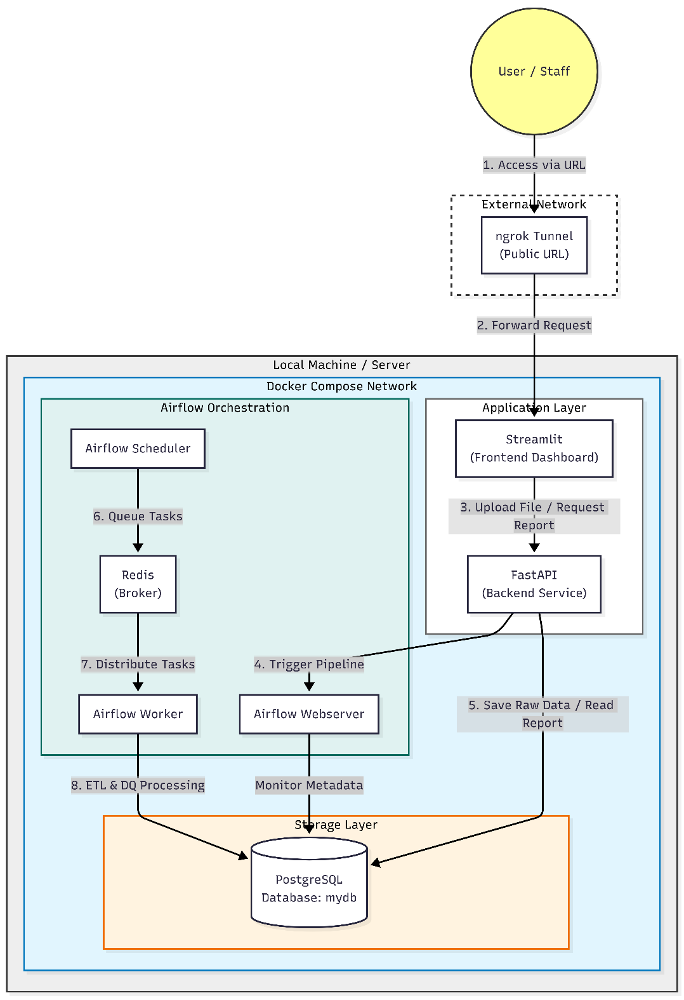
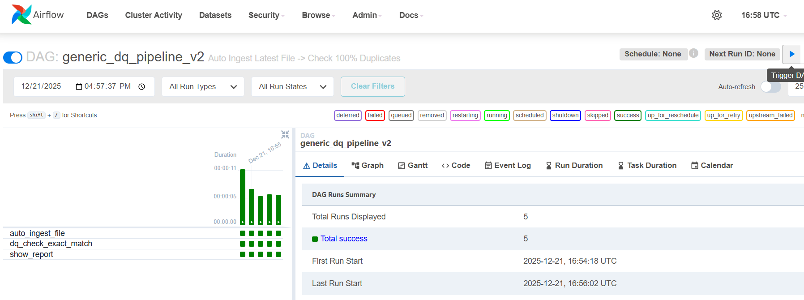
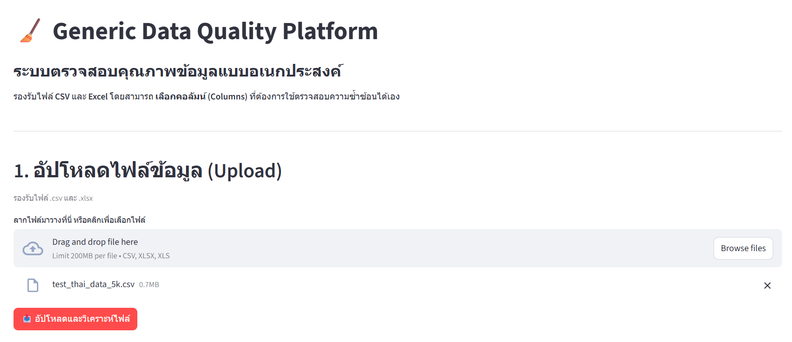
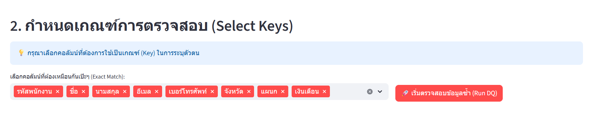
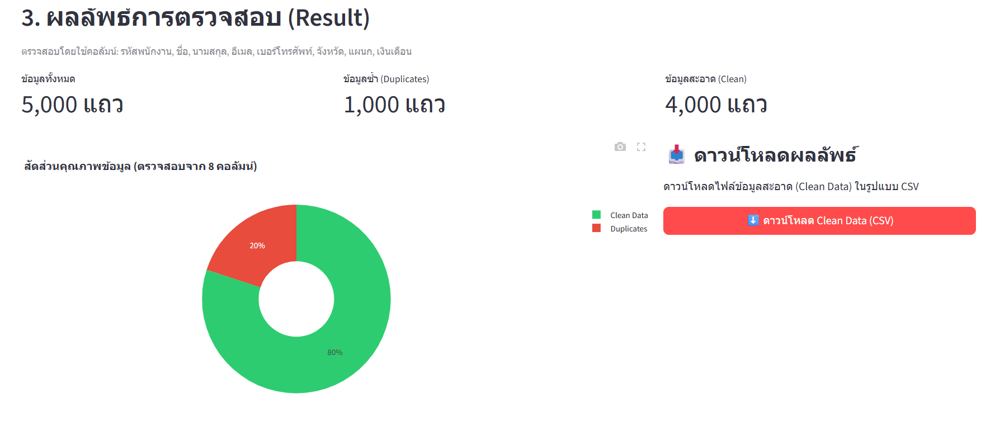
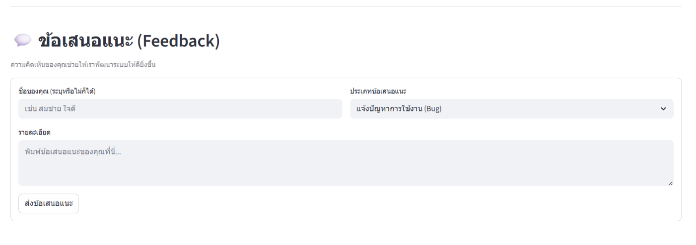
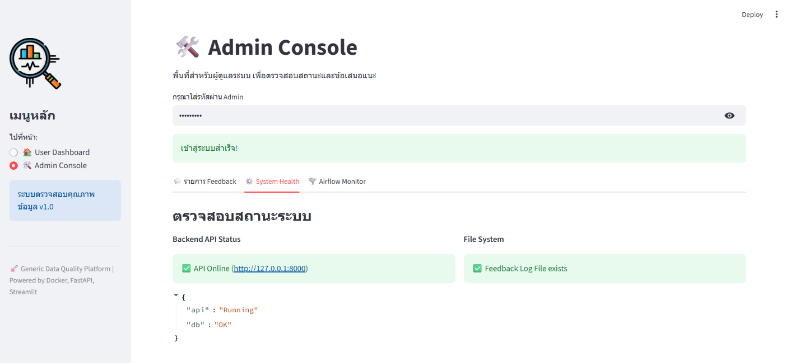
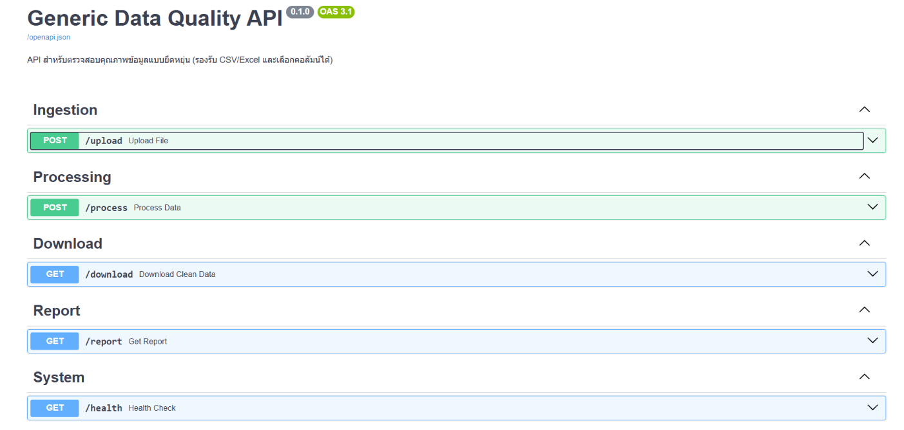
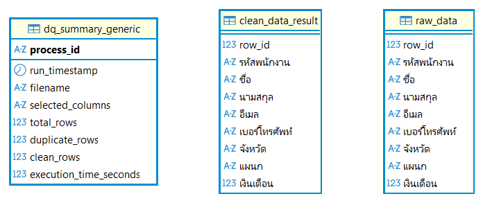

# Generic Data Quality Platform

แพลตฟอร์มบริหารจัดการคุณภาพข้อมูลแบบอเนกประสงค์ สำหรับ **ตรวจสอบและขจัดข้อมูลซ้ำซ้อน (Deduplication)**
จากไฟล์ CSV / Excel โดยผู้ใช้เลือกคอลัมน์ที่ใช้เป็นเกณฑ์ตรวจสอบได้เอง
แล้วดูผลผ่าน Dashboard และดาวน์โหลดข้อมูลสะอาด (Clean Data) ได้ทันที

> *Development of a Generic Data Quality Platform for Data Inspection and Deduplication*

## Key Features

- **อัปโหลดไฟล์ `.csv` / `.xlsx` / `.xls`** (สูงสุด 200MB ต่อไฟล์) ระบบอ่านโครงสร้างและแสดงรายชื่อคอลัมน์ให้อัตโนมัติ
- **เลือกคอลัมน์เกณฑ์ตรวจสอบเอง (User-Selected Keys)** ให้ตรงกับบริบทของข้อมูลแต่ละชุด
- **Dashboard สรุปผล** จำนวนข้อมูลทั้งหมด / ข้อมูลซ้ำ / ข้อมูลสะอาด พร้อมกราฟสัดส่วน
- **ดาวน์โหลด Clean Data** เป็น CSV ผ่าน API
- **ท่อส่งข้อมูลอัตโนมัติด้วย Apache Airflow** (ค้นหาไฟล์ล่าสุด → นำเข้า → ตรวจซ้ำ → รายงานผล)
- **Feedback + Admin Console** รับข้อเสนอแนะจากผู้ใช้ ตรวจสถานะระบบ และลิงก์ไป Airflow UI
- **REST API** พร้อมเอกสาร Swagger อัตโนมัติ

## System Architecture

ทำงานบน Docker Compose แบบ Microservices แยกส่วน ฐานข้อมูล, ตัวควบคุมลำดับงาน, Backend API และ Frontend ออกจากกัน



| ส่วน | เทคโนโลยี | หน้าที่ |
|---|---|---|
| Frontend | Streamlit | อัปโหลดไฟล์ เลือกคอลัมน์ แสดงผลและกราฟ ดาวน์โหลดผลลัพธ์ |
| Backend API | FastAPI | รับไฟล์ สั่งประมวลผล ส่งคืนรายงานและไฟล์ Clean Data |
| Orchestrator | Apache Airflow (Scheduler / Worker / Webserver + Redis) | ควบคุมท่อส่งข้อมูลและประมวลผล ETL / DQ |
| Database | PostgreSQL | เก็บข้อมูลดิบ ผลลัพธ์ และประวัติรายงาน |
| Tunnel (ทางเลือก) | ngrok | เปิด URL สาธารณะให้ทดลองใช้จากภายนอก |

## Data Pipeline (Airflow DAG)

DAG `generic_dq_pipeline_v2` ประกอบด้วย 3 ขั้นตอน ได้แก่ `auto_ingest_file` (ค้นหาไฟล์ล่าสุดแล้วนำเข้า)
→ `dq_check_exact_match` (ตรวจข้อมูลซ้ำแบบตรงกันทุกคอลัมน์ที่เลือก) → `show_report` (บันทึกและแสดงรายงาน)



## Screenshots

### 1) File Upload & Key Selection




### 2) Results & Clean Data Download



### 3) User Feedback



### 4) Admin Console (Password Protected)

ตรวจรายการ Feedback ดูสถานะระบบ (System Health) และเปิด Airflow UI ได้จากจุดเดียว



## API

เอกสาร Swagger UI อยู่ที่ `http://localhost:8000/docs`

| Method | Endpoint | หน้าที่ |
|---|---|---|
| POST | `/upload` | อัปโหลดไฟล์ข้อมูล |
| POST | `/process` | สั่งประมวลผลตรวจข้อมูลซ้ำตามคอลัมน์ที่เลือก |
| GET | `/download` | ดาวน์โหลด Clean Data |
| GET | `/report` | ดึงรายงานผลการตรวจสอบ |
| GET | `/health` | ตรวจสถานะ API และฐานข้อมูล |



## Database Schema

- `dq_summary_generic` – ประวัติรายงานแต่ละครั้ง (process_id, run_timestamp, filename, selected_columns, total_rows, duplicate_rows, clean_rows, execution_time_seconds)
- `raw_data` – ข้อมูลดิบที่นำเข้า
- `clean_data_result` – ข้อมูลสะอาดหลังขจัดข้อมูลซ้ำ

`raw_data` และ `clean_data_result` เป็นตารางแบบ Dynamic โครงสร้างเปลี่ยนไปตามไฟล์ที่ผู้ใช้อัปโหลด (ภาพตัวอย่างเป็นข้อมูลพนักงาน)



## Project Structure

```
.
├── dags/                    # Airflow DAG (data_quality_pipeline.py)
├── scripts/
│   ├── api.py               # FastAPI backend
│   ├── app_frontend.py      # Streamlit frontend
│   └── data_functions.py    # ฟังก์ชันนำเข้า/ตรวจข้อมูลซ้ำ/เชื่อมฐานข้อมูล
├── data/                    # ข้อมูลตัวอย่าง (ข้อมูลสังเคราะห์)
├── post/docker-compose.yml  # Postgres แยกสำหรับทดสอบ
├── docker-compose.yaml      # Airflow + PostgreSQL + Redis
├── requirements.txt
└── .env.example             # แม่แบบค่าตั้งต้น (รหัสผ่าน)
```

## Installation & Usage

### Prerequisites
- Docker Desktop
- Python 3.11 ขึ้นไป

### 1) Configure environment
```bash
cp .env.example .env        # Windows: copy .env.example .env
```
เปิดไฟล์ `.env` แล้วเปลี่ยน `change_me` เป็นรหัสผ่านของตัวเอง
(`DB_PASSWORD`, `AIRFLOW_ADMIN_PASSWORD`, `ADMIN_PASSWORD`)

### 2) Start Docker (Airflow + PostgreSQL + Redis)
```bash
docker-compose up -d
```
> บน Windows ถ้ามี PostgreSQL ติดตั้งในเครื่องและใช้พอร์ต 5432 อยู่ ให้หยุดก่อน
> (เช่น `net stop postgresql-x64-18` ใน cmd แบบ Administrator)

### 3) Install dependencies
```bash
pip install -r requirements.txt
```

### 4) Run the backend (FastAPI)
```bash
cd scripts
python -m uvicorn api:app --reload --host 0.0.0.0 --port 8000
```

### 5) Run the frontend (Streamlit) — in a new terminal
```bash
python -m streamlit run scripts/app_frontend.py
```

### 6) Open the services

| บริการ |
|---|
| Dashboard (Streamlit) |
| API Docs (Swagger) |
| Airflow UI |

### (Optional) Public URL with ngrok
ติดตั้ง ngrok จาก https://ngrok.com/download แล้วรัน
```bash
ngrok http 8501
```

## Security

- รหัสผ่านทั้งหมดอยู่ในไฟล์ `.env` ซึ่งถูก `.gitignore` ไว้ ห้ามนำขึ้น repo
- ข้อมูลใน `data/` เป็นข้อมูลสังเคราะห์สำหรับทดสอบเท่านั้น
- ก่อนเปิดให้ผู้อื่นเข้าถึงผ่าน ngrok ควรตั้ง `ADMIN_PASSWORD` ที่คาดเดายาก

## Tech Stack

Python · FastAPI · Streamlit · Plotly · pandas · SQLAlchemy · PostgreSQL · Apache Airflow · Redis · Docker Compose
